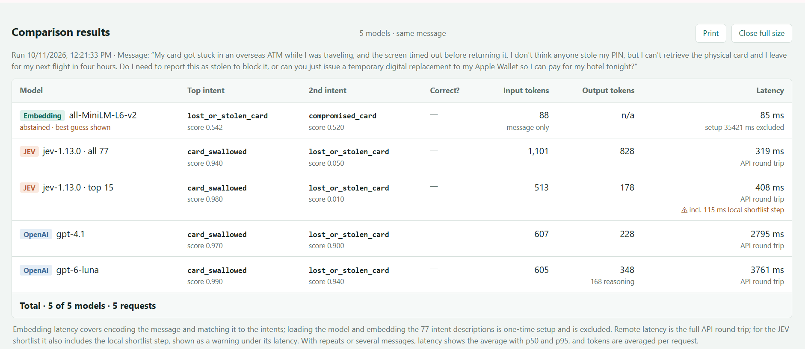
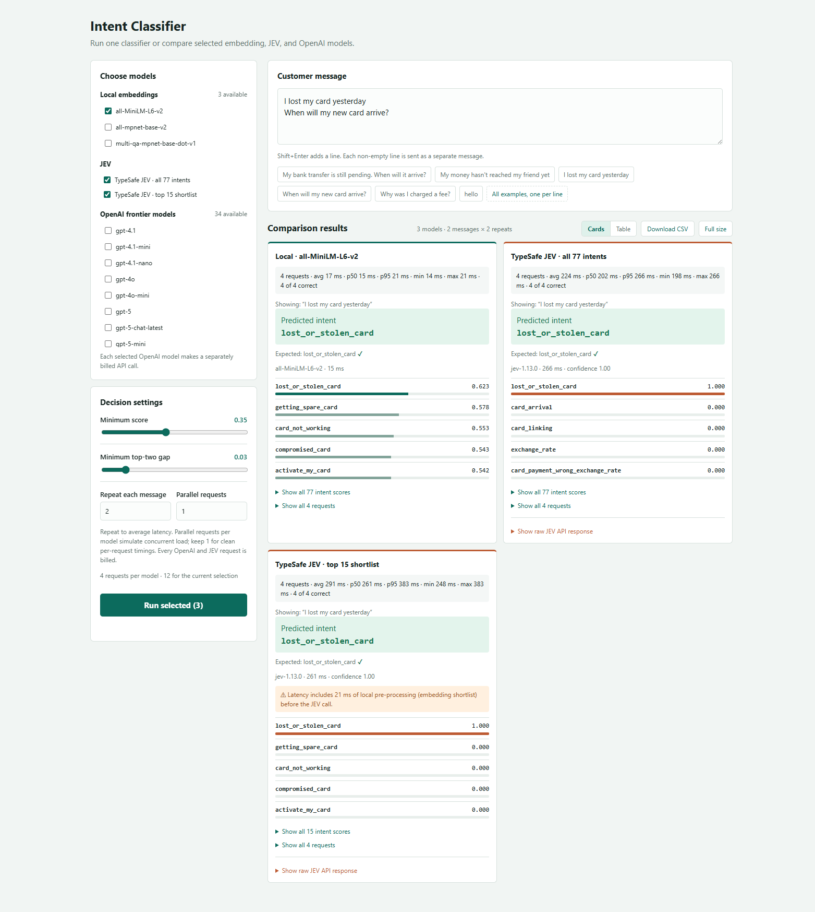
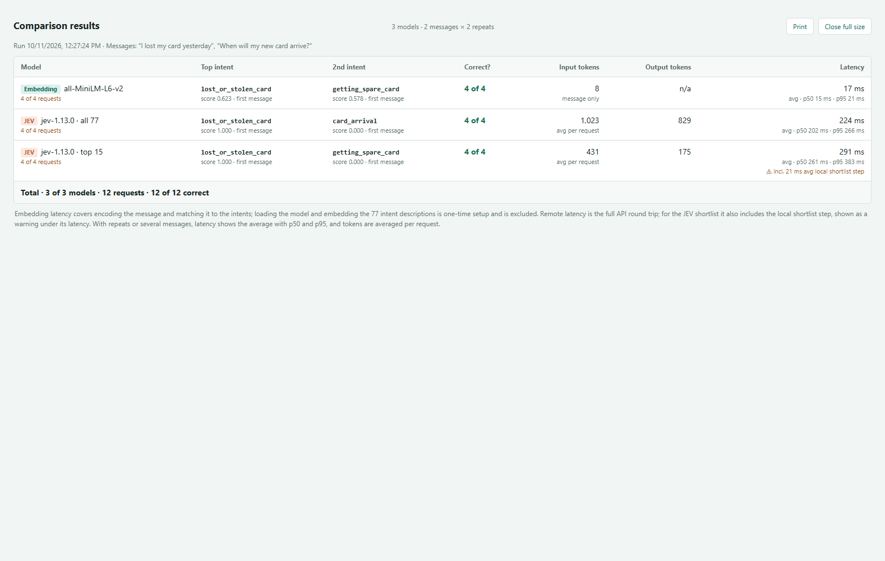
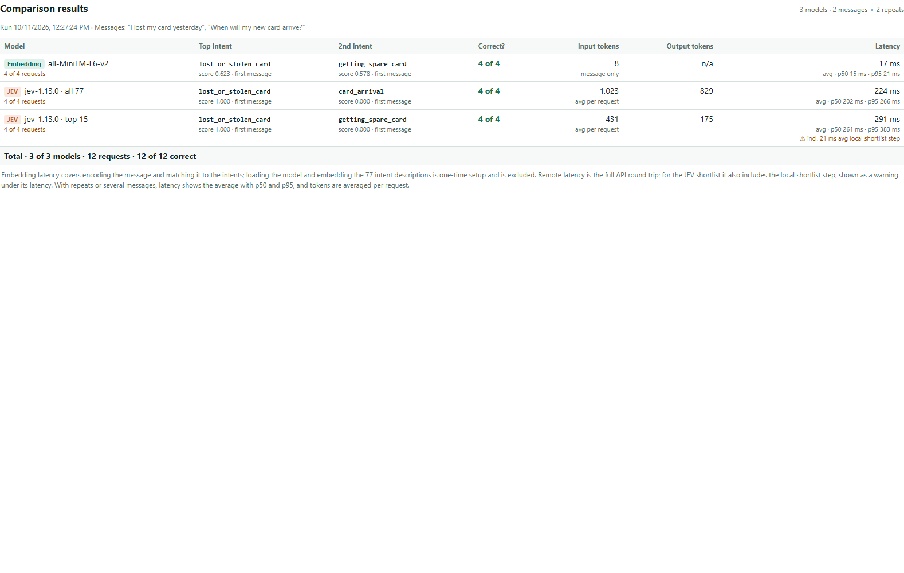

# Results

Screenshots from runs of the Intent Classifier on 11 Oct 2026, using
`jev-1.13.0` and a JEV shortlist size of 15.

## 1. One long message, five models

One request per model (not averaged) with a long customer message about a card
stuck in an overseas ATM. The models were all-MiniLM-L6-v2 (local embedding),
JEV with all 77 intents, JEV with the top 15 shortlist, gpt-4.1 and gpt-6-luna.
The message is not a built-in example, so "Correct?" is blank. The main
[README](../README.md#example-result) has this table as text, with notes on
what it shows.

## 2. Batch test: 2 messages × 2 repeats, three models

Two built-in example messages ("I lost my card yesterday" and "When will my new
card arrive?"), each sent twice to three models, one request at a time
(Parallel requests = 1). That makes 12 requests in total.

| Model | Correct | Avg input tokens | Avg output tokens | Avg latency | p50 | p95 |
|---|---|---:|---:|---:|---:|---:|
| Embedding · all-MiniLM-L6-v2 | 4 of 4 | 8 | n/a | 17 ms | 15 ms | 21 ms |
| JEV · all 77 | 4 of 4 | 1,023 | 829 | 224 ms | 202 ms | 266 ms |
| JEV · top 15 | 4 of 4 | 431 | 175 | 291 ms (incl. 21 ms shortlist step) | 261 ms | 383 ms |

Each model sent only four requests, so p95 here is simply the slowest one.

**Cards view**: per-model latency summary, the result for the first message,
and the ⚠ note on the JEV shortlist card.

**Full size view**: the table on its own, with the run date and messages.

**Print layout**: what **Print** produces (controls and buttons hidden).

